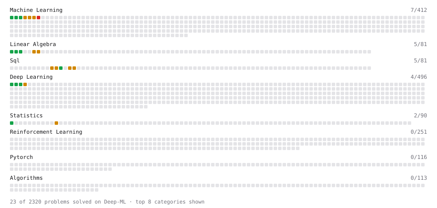

# Deep-ML

My machine learning practice from [Deep-ML](https://www.deep-ml.com). Every solution here was written by hand.

**24** solved · 23 problems · 0 labs · 1 math

[**Browse the interactive portfolio**](https://Adirom0901.github.io/deep-ml/) to replay this filling in over time.

## Problems

| | Difficulty | Solved | |
| --- | --- | --- | --- |
| [Calculate Covariance Matrix](https://www.deep-ml.com/problems/10) | easy | 2026-10-10 | [solution](problems/0010-calculate-covariance-matrix) |
| [Delete Duplicate Emails Keeping One](https://www.deep-ml.com/problems/1112) | easy | 2026-11-16 | [solution](problems/1112-delete-duplicate-emails-keeping-one) |
| [Feature Scaling Implementation](https://www.deep-ml.com/problems/16) | easy | 2026-10-11 | [solution](problems/0016-feature-scaling-implementation) |
| [Linear Regression Using Gradient Descent](https://www.deep-ml.com/problems/15) | easy | 2026-10-10 | [solution](problems/0015-linear-regression-using-gradient-descent) |
| [Linear Regression Using Normal Equation](https://www.deep-ml.com/problems/14) | easy | 2026-10-10 | [solution](problems/0014-linear-regression-using-normal-equation) |
| [Matrix-Vector Dot Product](https://www.deep-ml.com/problems/1) | easy | 2026-10-06 | [solution](problems/0001-matrix-vector-dot-product) |
| [Reshape Matrix](https://www.deep-ml.com/problems/3) | easy | 2026-10-10 | [solution](problems/0003-reshape-matrix) |
| [Sigmoid Activation Function Understanding](https://www.deep-ml.com/problems/22) | easy | 2026-10-15 | [solution](problems/0022-sigmoid-activation-function-understanding) |
| [Single Neuron](https://www.deep-ml.com/problems/24) | easy | 2026-10-15 | [solution](problems/0024-single-neuron) |
| [Softmax Activation Function Implementation ](https://www.deep-ml.com/problems/23) | easy | 2026-10-15 | [solution](problems/0023-softmax-activation-function-implementation) |
| [Transpose of a Matrix](https://www.deep-ml.com/problems/2) | easy | 2026-10-10 | [solution](problems/0002-transpose-of-a-matrix) |
| [Calculate Eigenvalues of a Matrix](https://www.deep-ml.com/problems/6) | medium | 2026-10-10 | [solution](problems/0006-calculate-eigenvalues-of-a-matrix) |
| [Implement K-Fold Cross-Validation](https://www.deep-ml.com/problems/18) | medium | 2026-10-11 | [solution](problems/0018-implement-k-fold-cross-validation) |
| [K-Means Clustering](https://www.deep-ml.com/problems/17) | medium | 2026-10-11 | [solution](problems/0017-k-means-clustering) |
| [Matrix Transformation ](https://www.deep-ml.com/problems/7) | medium | 2026-10-10 | [solution](problems/0007-matrix-transformation) |
| [Maximum Likelihood Estimation for Gaussian Distribution](https://www.deep-ml.com/problems/337) | medium | 2026-11-17 | [solution](problems/0337-maximum-likelihood-estimation-for-gaussian-distribution) |
| [Month-over-Month Percentage Change with LAG](https://www.deep-ml.com/problems/1115) | medium | 2026-11-16 | [solution](problems/1115-month-over-month-percentage-change-with-lag) |
| [Nth-Highest Salary with Ties and NULL](https://www.deep-ml.com/problems/1110) | medium | 2026-11-16 | [solution](problems/1110-nth-highest-salary-with-ties-and-null) |
| [Principal Component Analysis (PCA) Implementation](https://www.deep-ml.com/problems/19) | medium | 2026-10-11 | [solution](problems/0019-principal-component-analysis-pca-implementation) |
| [Rank Rows Within Partitions Using Window Functions](https://www.deep-ml.com/problems/1114) | medium | 2026-11-17 | [solution](problems/1114-rank-rows-within-partitions-using-window-functions) |
| [Single Neuron with Backpropagation](https://www.deep-ml.com/problems/25) | medium | 2026-10-15 | [solution](problems/0025-single-neuron-with-backpropagation) |
| [Top-3 Salaries Per Department](https://www.deep-ml.com/problems/1111) | medium | 2026-11-16 | [solution](problems/1111-top-3-salaries-per-department) |
| [Decision Tree Learning](https://www.deep-ml.com/problems/20) | hard | 2026-10-12 | [solution](problems/0020-decision-tree-learning) |

## Math

| | Difficulty | Solved | |
| --- | --- | --- | --- |
| [Bayesian Methods](https://www.deep-ml.com/math-problems/28) | hard | 2026-11-17 | [solution](math/0028-bayesian-methods) |

---

_This file is regenerated by Deep-ML on every push._
